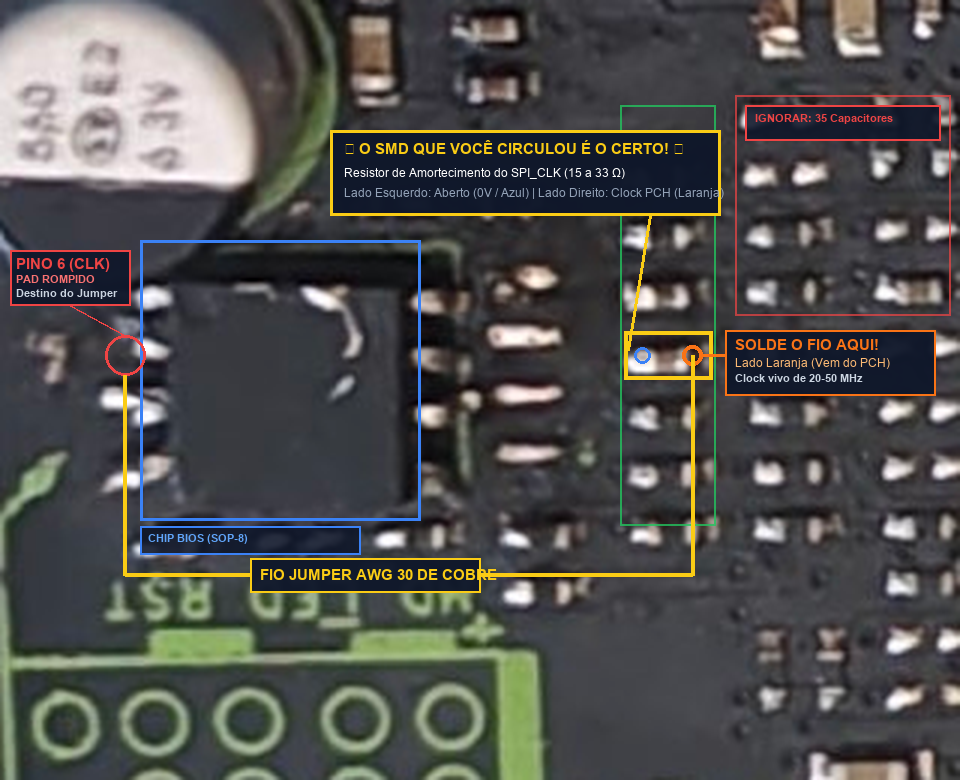
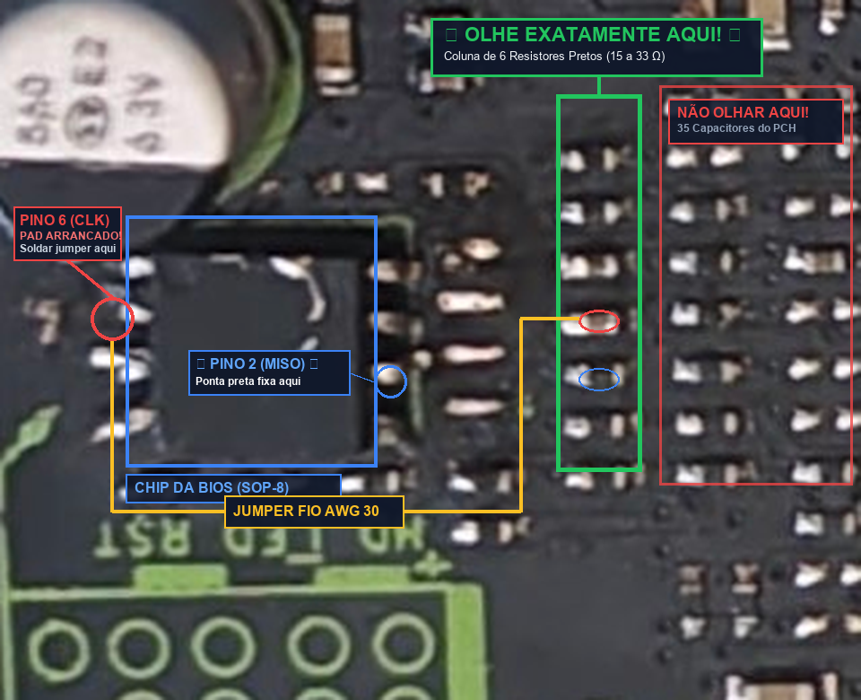

# Jieshuo X99-XD4 V2.0 — Recuperação da Linha SPI_CLK (Pino 6 da BIOS)

Guia técnico de engenharia reversa, diagnóstico de bancada e firmware para microcontroladores ESP32 (ESP32-C6, ESP32-S3 e ESP32 Clássico) para identificação física e recuperação do pad arrancado da linha de clock (`SPI_CLK` / Pino 6) na placa-mãe **Jieshuo X99-XD4 V2.0** (Chipset Intel Wellsburg C612 / LGA 2011-3).

---

## 📌 Sumário
1. [O Problema e o Erro das Análises Anteriores](#1-o-problema-e-o-erro-das-análises-anteriores)
2. [O SMD Correto Confirmado em Bancada](#2-o-smd-correto-confirmado-em-bancada)
3. [Mapeamento Físico em Zoom Macro (300%)](#3-mapeamento-físico-em-zoom-macro-300)
4. [Por que a Emulação Clockless ou Sem Contato é Impossível](#4-por-que-a-emulação-clockless-ou-sem-contato-é-impossível)
5. [Firmware Testador de Bancada com ESP32](#5-firmware-testador-de-bancada-com-esp32)
6. [Como Flashear os Binários Pré-Compilados (.bin)](#6-como-flashear-os-binários-pré-compilados-bin)
7. [O Procedimento de Solda do Jumper](#7-o-procedimento-de-solda-do-jumper)
8. [Pinagem RomEMU (DatanoiseTV)](#8-pinagem-romemu-datanoisetv)

---

## 1. O Problema e o Erro das Análises Anteriores

Durante a dessoldagem do chip de BIOS (SOP-8, Winbond W25Q128FV) na Jieshuo X99-XD4, o **pad 6 (`SPI_CLK`) foi arrancado da superfície do PCB**. Como a placa possui 6 camadas e usa tecnologia *Via-in-Pad*, a trilha de clock não corre pela superfície externa.

Modelos de IA anteriores (ChatGPT, Hermes) falharam na identificação por dois motivos:
1. **Inversão de Orientação (180°):** Confundiram a posição do capacitor eletrolítico `CE43` (superior) com o conector `HD_LED RST` (inferior), invertendo os lados dos pinos da BIOS.
2. **Ilusão da Grade de Capacitores:** A matriz densa de 35 componentes à direita foi confundida com resistores. Na realidade, são **35 capacitores cerâmicos MLCC de desacoplamento das fontes de 1,05V / 3,3V do chipset PCH C612**, totalmente irrelevantes para o barramento SPI.

---

## 2. O SMD Correto Confirmado em Bancada

Na sessão de bancada com medição ativa de ADC e injeção de 3.3V, o componente exato circulado em vermelho pelo usuário foi diagnosticado terminal a terminal:



```
[LADO DO CHIPSET C612]                                [LADO DA BIOS]
       (Direita)                                         (Esquerda)
           |                                                 |
     🟠 LARANJA                                          🔵 AZUL
   (~0.8V a 2.4V)                                      (0.00 V / Aberto)
           |                                                 |
           +-----[ RESISTOR PRETO 0402 (15-33 Ω) ]-----------+---- (Trilha Rompida) ---X (Pino 6 Arrancado)
           |
   ★ SOLDE O FIO AQUI ★
```

* **Terminal Esquerdo (Lado da BIOS):** Retornou **0.00 V / AZUL** (circuito 100% aberto — confirmando que este terminal era o que ligava no pad 6 arrancado).
* **Terminal Direito (Lado do PCH / Dissipador):** Retornou **~0.8V a 2.4V / LARANJA** (sinal de clock vivo que vem direto da esfera BGA do chipset Intel C612).
* **Ponto de Solda:** Solde o fio de micro-solda (AWG 30) diretamente no **Terminal Direito (Lado Laranja)**.

---

## 3. Mapeamento Físico em Zoom Macro (300%)



### Zonas Identificadas:
* **Chip da BIOS (Caixa Azul):** Encapsulamento SOP-8 localizado estritamente entre o capacitor `CE43` e a serigrafia `HD_LED RST`.
* **Pino 6 Arrancado (Círculo Vermelho à Esquerda):** Segundo terminal descendo pelo lado esquerdo do chip.
* **Pino 2 / MISO Guia (Círculo Azul à Direita):** Terceiro terminal descendo pelo lado direito.
* **Corredor Alvo — Grupo A (Caixa Verde):** Coluna vertical de **exatamente 6 resistores pretos SMD 0402** colada à direita dos pads da BIOS.
* **Grade do Chipset (Caixa Vermelha — IGNORAR):** 35 capacitores MLCC bege/marrons.

---

## 4. Por que a Emulação Clockless ou Sem Contato é Impossível

1. **Intel C612 é estritamente SPI Master:** O chipset gera trens de pulsos sob demanda e amostra a linha `MISO` usando internamente esse mesmo clock. Ele não possui circuito de *Clock-Data Recovery* (CDR).
2. **Assincronia Fatal de Cristais:** A deriva térmica entre o cristal da placa (25 MHz) e o do microcontrolador (40 MHz) causa perda de fase em menos de $20\ \mu\text{s}$, corrompendo a leitura da BIOS com código POST `00` ou `FF`.
3. **Divisor Capacitivo Inválido:** Captar o sinal pelo ar via acoplamento capacitivo atenua o sinal de 3,3V para meros $36\text{ mV}$ ($C_c \approx 33\text{ fF}$ vs $C_{in} \approx 3\text{ pF}$), com razão sinal-ruído negativa diante do ruído de comutação do VRM do PCH.

---

## 5. Firmware Testador de Bancada com ESP32

O firmware utiliza injeção ativa de 3.3V com leitura por conversor analógico-digital (ADC puro de alta impedância) com média de 16 amostragens para rejeitar ruídos eletrostáticos e fugas de silício:

```cpp
#include <Arduino.h>

#define RGB_PIN 8 // LED ARGB integrado no ESP32-C6 (WS2812)
#define ADC_PIN 0 // GPIO 0 (ADC1_CH0 puro)

void setup() {
  Serial.begin(115200);
  analogReadResolution(12);
  pinMode(ADC_PIN, INPUT);
}

void loop() {
  long sum = 0;
  for (int i = 0; i < 16; i++) {
    sum += analogRead(ADC_PIN);
    delayMicroseconds(100);
  }
  float voltage = ((sum / 16) / 4095.0) * 3.3;

  if (voltage > 3.0) {
    rgbLedWrite(RGB_PIN, 0, 255, 0);     // VERDE: Trilha direta 0 ohms / 3.3V pleno
  } else if (voltage > 0.3) {
    rgbLedWrite(RGB_PIN, 255, 120, 0);   // LARANJA: Fuga de silício do Chipset PCH
  } else {
    rgbLedWrite(RGB_PIN, 0, 15, 70);     // AZUL: Circuito Aberto / Isolado (0V)
  }
  delay(20);
}
```

---

## 6. Como Flashear os Binários Pré-Compilados (.bin)

Os binários compilados já estão gerados no repositório na pasta `binaries/`:

### Para ESP32-C6:
```bash
esptool --chip esp32c6 --port COM8 --baud 921600 write_flash 0x0 binaries/esp32c6/ESP32_Continuity_Tester.ino.bootloader.bin 0x8000 binaries/esp32c6/ESP32_Continuity_Tester.ino.partitions.bin 0x10000 binaries/esp32c6/ESP32_Continuity_Tester.ino.bin
```

### Para ESP32-S3:
```bash
esptool --chip esp32s3 --port COM8 --baud 921600 write_flash 0x0 binaries/esp32s3/ESP32_Continuity_Tester.ino.bootloader.bin 0x8000 binaries/esp32s3/ESP32_Continuity_Tester.ino.partitions.bin 0x10000 binaries/esp32s3/ESP32_Continuity_Tester.ino.bin
```

### Para ESP32 Clássico (ESP32-WROOM):
```bash
esptool --chip esp32 --port COM8 --baud 921600 write_flash 0x1000 binaries/esp32_generic/ESP32_Continuity_Tester.ino.bootloader.bin 0x8000 binaries/esp32_generic/ESP32_Continuity_Tester.ino.partitions.bin 0x10000 binaries/esp32_generic/ESP32_Continuity_Tester.ino.bin
```

---

## 7. O Procedimento de Solda do Jumper

1. Utilizar fio de cobre esmaltado fino (**AWG 30 ou AWG 32**).
2. Soldar uma das pontas no **Terminal Direito (Lado Laranja / voltado para o PCH)** do resistor identificado na Seção 2.
3. Contornar o fio por baixo do chip da BIOS para não sofrer indução eletromagnética de alta frequência dos pinos de dados.
4. Soldar a outra ponta diretamente na **perna 6 do chip SOP-8 (W25Q128FV)** ou no **GPIO 12 do ESP32-S3**.
5. Aplicar uma gotícula de máscara UV (Solder Mask UV) e curar com luz ultravioleta por 60 segundos para fixar mecanicamente o jumper.

---

## 8. Pinagem RomEMU (DatanoiseTV)

Caso a placa utilize o emulador de BIOS de hardware **RomEMU** em vez do chip físico:

| Pino BIOS (SOP-8) | Linha SPI | ESP32-S3 (IOMUX Direto) | Função no Emulador |
| :--- | :--- | :--- | :--- |
| **Pino 1** | CS# | GPIO 10 | Chip Select Virtual |
| **Pino 2** | DO / MISO | GPIO 13 | Envio de dados para a placa |
| **Pino 3** | WP# | GPIO 14 | Proteção de escrita / Quad I/O |
| **Pino 4** | GND | GND | Referência de 0V comum |
| **Pino 5** | DI / MOSI | GPIO 11 | Entrada de comandos e endereços do PCH |
| **Pino 6** | **CLK** | **GPIO 12** | **Entrada obrigatória do Clock (Jumper do Resistor)** |
| **Pino 7** | HOLD# | GPIO 9 | Controle Quad I/O |
| **Pino 8** | VCC | *Isolado* | ESP32 alimentado exclusivamente pela USB |

*Nota de Firmware:* Ajustar a frequência do descritor SPI da BIOS para **20 MHz** (Single SPI / 0Bh) com o UEFITool / FITC para respeitar o limite de amostragem do periférico SPI Slave do ESP32.

---

## 🔗 Referências & Links
* Projeto Completo no Figma: [X99-XD4 Guia Técnico SPI_CLK](https://www.figma.com/design/H2pGeJ6bOAtwjOJB4u5JXb)
* Repositório DatanoiseTV RomEMU: [github.com/DatanoiseTV/RomEMU](https://github.com/DatanoiseTV/RomEMU)
* Intel C610 Series Chipset Datasheet: Document Number 330784-001
